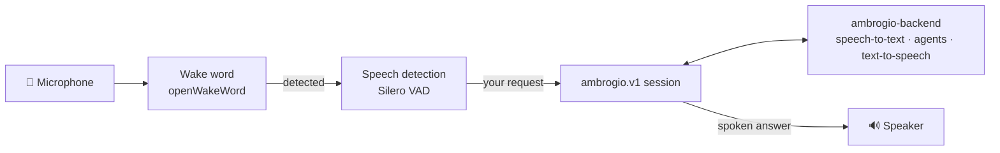
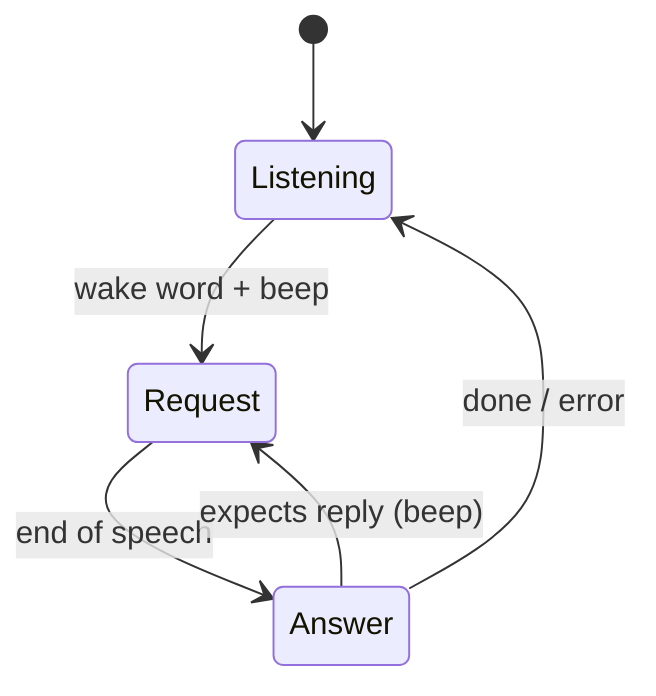

<p align="center">
  <picture>
    <source media="(prefers-color-scheme: dark)" srcset=".github/logo-dark.svg">
    
  </picture>
</p>

# Ambrogio — voice satellite

**Ambrogio** is an open source home assistant that you host yourself. This repository is its **voice satellite**: a small program that listens for a wake word, sends what you say to the Ambrogio backend and plays back the spoken answer. Put one in each room on any Linux machine that has a microphone and a speaker, such as a Raspberry Pi or a mini PC.

| Repository | Role |
|---|---|
| [ambrogio-backend](https://github.com/ambrogio-app/ambrogio-backend) | Conversation server, agents, speech, storage, public protocol |
| [ambrogio-cli](https://github.com/ambrogio-app/ambrogio-cli) | Terminal chat client |
| **ambrogio-satellite** (this one) | Voice satellite with wake word, microphone and speaker |

> Ambrogio is in early development. Testing with real audio hardware on x86_64 and arm64 is still in progress.

## How it works

1. Say the wake word (**"Hey Jarvis"** by default) and wait for the short beep.
2. Ask your question. The satellite detects when you stop speaking.
3. Ambrogio answers out loud.
4. If the answer expects a reply, the beep sounds again and you can respond without repeating the wake word.



- **Local wake word.** Wake word detection runs entirely on the satellite. No audio leaves the device until the wake word is heard, and the satellite never writes captured audio to disk. It also keeps a short audio buffer, so you can say *"Hey Jarvis, …"* as one sentence.
- **Backend does the heavy lifting.** The satellite sends raw 16 kHz audio over the backend's `ambrogio.v1` WebSocket session and receives audio back. Transcription, the AI agents and speech synthesis all run on the backend.
- **Conversations.** Each wake word starts a new conversation, and a follow-up reply continues the same one. The backend decides whether it expects a reply. Conversations are stored on the backend, so you can also read or continue them from the [terminal client](https://github.com/ambrogio-app/ambrogio-cli).
- **Graceful failures.** If the backend cannot be reached, or voice is not enabled on it, the satellite plays a short error tone (two descending notes) and goes back to listening for the wake word. The logs record the cause.



## Dependencies

**Runtime**

- Linux on x86_64 or arm64
- Node.js 24 or later, with pnpm. Docker is optional
- ALSA runtime (`libasound.so.2`) and OpenMP (`libgomp.so.1`)
- `amixer` from `alsa-utils`, only if you use `audio.attenuation` (the Docker image includes it)
- A microphone and a speaker that the process can access
- A running [ambrogio-backend](https://github.com/ambrogio-app/ambrogio-backend) with voice enabled

**Main libraries**

| Area | Library |
|---|---|
| Microphone, speaker, voice activity detection | [Decibri](https://www.npmjs.com/package/decibri) (includes Silero VAD) |
| Wake word | [openWakeWord](https://github.com/dscripka/openWakeWord) models on `onnxruntime-node` |
| Backend connection | Node's built-in `WebSocket` |
| Logging | Pino, as JSON lines on stdout |

The wake word models included here are **"Hey Jarvis"**, **"Hey Mycroft"** and **"Alexa"**. You can add your own openWakeWord-compatible model by mounting a models directory.

## Quick start

The [`config.example.ts`](config.example.ts) module reads the satellite settings from environment variables and exports a default object. `AMBROGIO_BACKEND_URL` is required; other settings have defaults or are optional. Node.js 24 imports the `.ts` module directly, and the satellite validates its values before opening audio or network resources.

For Docker Compose, use [`compose.example.yaml`](compose.example.yaml):

```bash
AMBROGIO_SATELLITE_VERSION=v0.5.0 AMBROGIO_BACKEND_URL=http://ambrogio.example.test:3000 \
  docker compose -f compose.example.yaml up -d
```

You can put these values and the optional `AMBROGIO_*` variables in a local `.env` file.

If you leave `audio` empty, the satellite uses the system's default microphone and speaker.

### Lowering other audio during an interaction

If a music player shares the satellite's speaker, the satellite can lower it while you talk. Route the player through an ALSA `softvol` device, which creates a volume control the satellite owns, and keep the satellite's own speaker outside it. For example, in `/etc/asound.conf`, with a `dmix` device named `mixer` on your sound card:

```
pcm.music {
    type softvol
    slave.pcm "mixer"
    control { name "Music"; card 0 }
}
```

Point the player at `music`, then name the control in the satellite configuration:

```bash
AMBROGIO_SPEAKER=alsa:mixer
AMBROGIO_ATTENUATION_DEVICE=hw:0
AMBROGIO_ATTENUATION_CONTROL=Music
AMBROGIO_ATTENUATION_LEVEL=25
```

When the wake word is heard, the satellite sets the control to `level` percent before the listening beep, keeps it there for the whole interaction, including follow-up replies, and sets it back to 100% when it returns to waiting for the wake word. It also sets it to 100% at startup and on shutdown. ALSA creates the control the first time something plays through `music`; until then there is nothing to lower. If `amixer` fails, the interaction continues and the satellite logs `satellite_attenuation_failed`.

**On the host**

```bash
pnpm install --frozen-lockfile
pnpm build
AMBROGIO_BACKEND_URL=http://ambrogio.example.test:3000 node dist/main.js --config config.example.ts
```

**With Docker**

```bash
docker build -t ambrogio-satellite .
docker run --rm --network host --device /dev/snd \
  -v "$PWD/config.example.ts:/config/satellite.ts:ro" \
  -e AMBROGIO_BACKEND_URL=http://ambrogio.example.test:3000 \
  ambrogio-satellite
```

Versioned multi-architecture images (amd64 and arm64) are published to `ghcr.io/ambrogio-app/ambrogio-satellite` for every `vX.Y.Z` tag. Hosts that run PipeWire or PulseAudio may need extra audio configuration.

## Repository layout

```
src/domain/        interaction states and rules
src/application/   use cases and ports
src/adapters/      audio, wake word, backend connection
src/composition/   wiring and configuration
models/            wake word and VAD models, with licenses
system-model/      engineering model (requirements, contracts, verifications)
```

## Development

```bash
pnpm test           # Vitest suite
pnpm typecheck
pnpm test:backend   # protocol test against a pinned ambrogio-backend revision
```

Secrets never belong in this repository. CI scans the whole Git history with [gitleaks](https://github.com/gitleaks/gitleaks) 8.30.1 on every push and pull request, and image publication waits for that scan. Locally, a versioned pre-commit hook blocks commits that add secrets; install gitleaks 8.30.1 on your `PATH` and enable the hook once per clone:

```bash
git config core.hooksPath .githooks
```

Ambrogio is developed model first with [Reqvire](https://reqvire.org/). This repository is self-contained: the repository root is its Reqvire workspace. [`system-model/`](system-model/) holds the satellite's own glossary, ontology, requirements, contracts and verifications, so you can read it without the backend's model. It also records which version of the backend's public `ambrogio.v1` contract the satellite is compatible with. [`AGENTS.md`](AGENTS.md) describes the workflow.

## Licenses

The satellite source code is released under the [MIT License](LICENSE).

The wake word and VAD models in [`models/`](models/) are third-party works with their own licenses. In particular, the bundled openWakeWord models are licensed **CC BY-NC-SA 4.0, for non-commercial use only**. See [`models/wakeword/README.md`](models/wakeword/README.md) and [`models/README.md`](models/README.md) for provenance and attribution.
